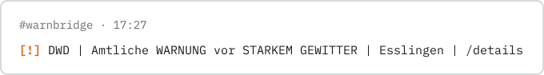
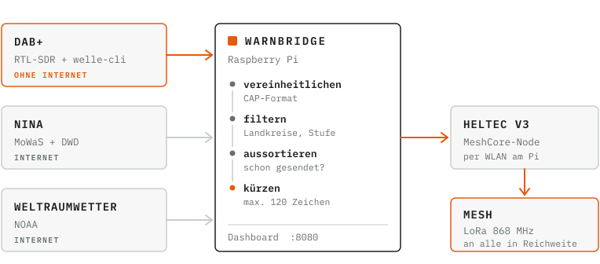
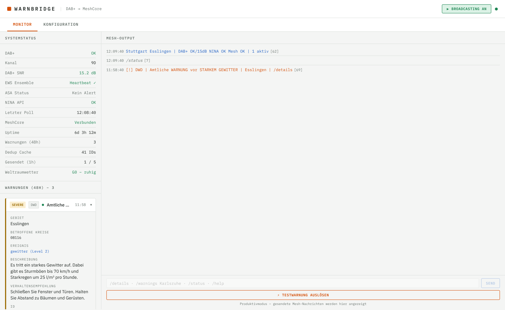
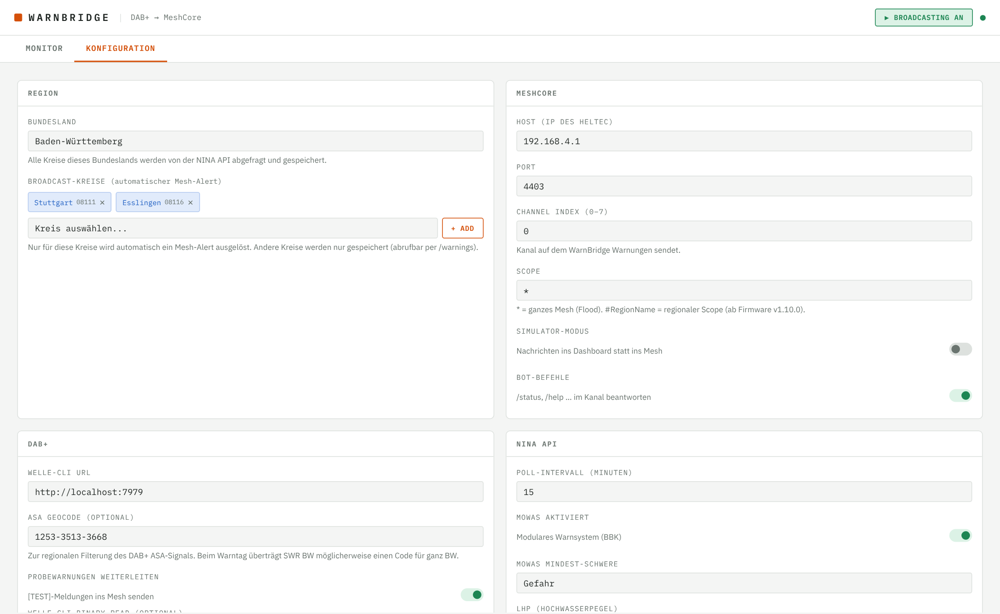

<p align="center">
  <picture>
    <source media="(prefers-color-scheme: dark)" srcset="docs/brand/logo-dark.svg">
    
  </picture>
</p>

<p align="center">Offizielle Warnungen aus dem DAB+-Radio ins MeshCore-Netz, auch ohne Internet.</p>

<p align="center">
  <picture>
    <source media="(prefers-color-scheme: dark)" srcset="docs/brand/message-dark.svg">
    
  </picture>
</p>

WarnBridge holt offizielle Warnmeldungen aus dem DAB+-Radio und schickt sie als kurze Textnachricht in ein MeshCore-Netz. Dazu kommen die Warnungen aus der NINA-App des Bundes, solange Internet da ist. Das Ganze läuft auf einem Raspberry Pi mit einem RTL-SDR-Stick und einem Heltec-LoRa-Node.

## Warum?

Bei einem großen Stromausfall sind Handynetz und Internet schnell weg – und damit NINA, Warn-Apps und Cell Broadcast. DAB+ läuft weiter: Die Sender haben Notstrom, und seit 2024 gibt es mit **ASA** (Automatic Safety Alert) einen Standard, über den Warnungen samt Text ausgestrahlt werden. Ein Radio hat aber nicht jeder dabei, ein MeshCore-Node schon eher.

WarnBridge verbindet beides: Der Pi hört das Radio ab, und wer in Reichweite des Mesh ist, bekommt die Warnung aufs Handy oder den Tracker – ganz ohne Internet. Mehr zur Idee hinter MeshCore im Off-Grid-Einsatz steht bei [FieldMesh](https://github.com/TogeriX-hub/FieldMesh).

## Wie es funktioniert

<picture>
  <source media="(prefers-color-scheme: dark)" srcset="docs/brand/architektur-dark.svg">
  
</picture>

Es gibt drei Quellen:

- **DAB+** – Der RTL-SDR-Stick empfängt einen Multiplex, eine angepasste Version von welle-cli dekodiert ihn. WarnBridge achtet auf das ASA-Signal und liest den Warntext aus dem Journaline-Datendienst.
- **NINA** – Alle 15 Minuten fragt WarnBridge die NINA-Schnittstelle ab: MoWaS-Warnungen des Katastrophenschutzes und DWD-Unwetterwarnungen für das eingestellte Bundesland.
- **Weltraumwetter** – Sonnenstürme und Funkausfälle von der NOAA, weil sie LoRa direkt betreffen.

Alles landet in einer gemeinsamen Datenbank. Ins Mesh geht nur, was die eingestellten Landkreise betrifft und die gewählte Stufe erreicht – und jede Warnung nur einmal. Bei einem langen Gewitter schickt der DWD zum Beispiel alle paar Minuten ein Update. WarnBridge sendet dann nur, wenn sich die Warnstufe wirklich ändert.

## Bot-Befehle im Mesh

Im Kanal kann jeder nachfragen:

| Befehl | Antwort |
|---|---|
| `/details` | Volltext der letzten Warnung (bis zu 3 Nachrichten), `/details 2` für die vorletzte |
| `/warnings` | Aktuelle Warnungen für die eigenen Landkreise |
| `/warnings Karlsruhe` | Aktuelle Warnungen für einen Ort im eingestellten Bundesland |
| `/status` | Kurzer Systemzustand: DAB+-Empfang, NINA, Mesh |
| `/swdetails` | Details zur aktuellen Weltraumwetter-Lage |
| `/help` | Übersicht |

Die Antworten gehen in denselben Kanal, also für alle sichtbar. Der Bot lässt sich im Dashboard abschalten, zum Beispiel wenn zwei WarnBridges im selben Kanal laufen.

## Dashboard

<picture>
  <source media="(prefers-color-scheme: dark)" srcset="docs/screenshots/dashboard-monitor-dark.png">
  
</picture>

<picture>
  <source media="(prefers-color-scheme: dark)" srcset="docs/screenshots/dashboard-konfiguration-dark.png">
  
</picture>

Unter `http://warnbridge.local:8080` zeigt das Dashboard, was gerade empfangen und gesendet wird. Es folgt der Hell/Dunkel-Einstellung des Geräts und braucht kein Internet, auch die Schrift liegt lokal. Dort stellst du auch alles ein: Bundesland, Landkreise, welche DWD-Warnungen ab welcher Stufe, DAB+-Kanal, MeshCore-Kanal. Änderungen gelten sofort, ohne Neustart. Mit dem Testbutton kannst du eine Probewarnung durch die ganze Kette schicken.

Zum Ausprobieren ohne Hardware gibt es einen Simulator-Modus: Statt ins Mesh gehen die Nachrichten ins Dashboard, und Bot-Befehle tippst du dort ein.

## Hardware

| Teil | Was ich nutze | Hinweis |
|---|---|---|
| Rechner | Raspberry Pi 4 (2 GB) | Wird im Dauerbetrieb warm, Kühlkörper lohnt sich |
| DAB+-Empfang | Nooelec NESDR SMArt v5 | Die Teleskopantenne aus dem Set reicht in der Wohnung nur knapp |
| MeshCore-Node | Heltec WiFi LoRa 32 v3 | Verbindet sich per WLAN mit dem Pi |
| Strom | EcoFlow River 2 | Pi, Stick und Heltec brauchen zusammen etwa 5 W |

Der Pi spannt ein eigenes WLAN für den Heltec auf. Dieser Teil braucht weder Router noch Internet. Nur NINA und Weltraumwetter laufen über das LAN-Kabel am Router.

## Installation

- **Raspberry Pi:** [docs/installation-pi.md](docs/installation-pi.md)
- **Mac (zum Entwickeln, mit Simulator):** [docs/installation-mac.md](docs/installation-mac.md)
- **Alle Einstellungen:** [docs/konfiguration.md](docs/konfiguration.md)

Kurz für den Mac:

```bash
git clone https://github.com/TogeriX-hub/dab-warnings-meshcore
cd dab-warnings-meshcore
bash install.sh
python3 warnbridge.py
```

## Stand

Meine WarnBridge läuft seit Sommer 2026 im Dauerbetrieb. Am bundesweiten Warntag (10.09.2026) kamen Probewarnung und Entwarnung pünktlich im Mesh an – über NINA. Unwetterwarnungen des DWD gehen seit dem Sommer zuverlässig raus.

Beim DAB+-Teil ist der Empfang fertig, und das ASA-Signal wird erkannt – live getestet mit dem Dauertest, den Deutschlandradio auf Kanal 5C alle fünf Minuten sendet. Am Warntag selbst lief der DAB+-Empfang auf dem falschen Kanal mit. Eine echte Warnung über DAB+ von Anfang bis Ende (Antenne → Pi → Mesh) steht deshalb noch aus.

## Grenzen und bekannte Probleme

- Welche DAB+-Multiplexe ASA dauerhaft senden, ist nicht öffentlich dokumentiert. Bei mir ist das Signal nur auf 5C sicher zu sehen, und das kommt in der Wohnung nur schwach an.
- Wie der Warntext bei einer echten MoWaS-Warnung im Journaline-Dienst aufgebaut ist, ist noch nicht an echten Daten geprüft.
- Ohne gute Antenne ist DAB+ in Gebäuden wackelig. Eine Antenne am Fenster bringt mehr als jede Einstellung.
- Der Heltec kann sich nach Wochen aufhängen. WarnBridge erkennt das inzwischen, startet den Node neu und schickt verlorene Nachrichten nach – ganz ausgeschlossen ist es aber nicht.
- Die Warnungen sind auf 120 Zeichen gekürzt. Der Volltext kommt per `/details`.
- WarnBridge ersetzt keine offizielle Warn-App und keine Sirene. Es ist eine zusätzliche Möglichkeit, wenn alles andere ausfällt.

## welle.io

Für den DAB+-Teil liegt eine angepasste Version von [welle.io](https://github.com/AlbrechtL/welle.io) im Ordner `welle.io/` (Fork: [TogeriX-hub/welle.io](https://github.com/TogeriX-hub/welle.io)). Gegenüber dem Original kann sie das ASA-Signal (FIG 0/15 nach ETSI TS 104 089) auswerten und Journaline-Texte mit dem Decoder von Fraunhofer IIS lesen. Beides gibt sie über die HTTP-Schnittstelle als `/mux.json` und `/journaline.json` aus.

## Wie WarnBridge entsteht

WarnBridge ist mein Projekt: Ich entscheide, was es tut, teste auf meiner eigenen Hardware und betreibe es selbst. Der Code entsteht zusammen mit Claude (Anthropic) als Programmierhilfe – zu sehen an den `Co-Authored-By`-Zeilen in den Commits.

Fragen, Fehlerberichte und Pull Requests sind willkommen, besonders Erfahrungen aus anderen Regionen mit ASA-Empfang.

## Verwandte Projekte

- [FieldMesh](https://github.com/TogeriX-hub/FieldMesh) – MeshCore-Firmware für Festivals, Wandern und Off-Grid-Einsatz
